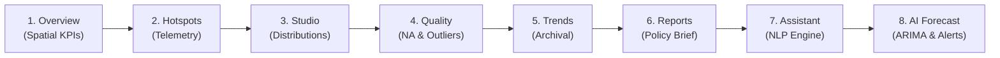

# Smart City Environmental Intelligence Dashboard

## 1. Project Title & Overview
**Smart City Environmental Intelligence Dashboard: Real-Time Air Quality Monitoring, Historical Trend Analysis, and Pollution Hotspot Detection Across India.**

This project delivers an interactive environmental intelligence dashboard developed in **R and R Shiny**. Grounded strictly in authentic, empirical monitoring data published by the **Central Pollution Control Board (CPCB)** via the **Open Government Data (OGD) Platform India (`data.gov.in`)**, the application provides spatial hotspot analysis, telemetry health audits, criteria pollutant distribution tracking, and evidence-grounded environmental insights.

---

## 2. Dataset Documentation & Provenance
* **Official Source:** Central Pollution Control Board (CPCB), Ministry of Environment, Forest and Climate Change, Government of India.
* **Portal Page:** [data.gov.in: Real-time Air Quality Index from various locations](https://www.data.gov.in/resource/real-time-air-quality-index-various-locations)
* **Primary Resource File:** `data/air_quality.csv` (Preserved unaltered)
* **Dataset Characteristics:**
  * **3,682 observations** across **11 variables**.
  * **526 continuous ambient air quality monitoring stations (CAAQM)** represented in the dataset.
  * **273 cities** across **31 States and Union Territories**.
  * **7 Criteria Pollutants:** $PM_{2.5}$, $PM_{10}$, $NO_2$, $SO_2$, $CO$, $OZONE$, $NH_3$.
  * **Geographic Conformance:** 100% of station coordinates fall within Indian territorial boundaries (Latitude: $8.515^\circ - 34.147^\circ\text{N}$, Longitude: $70.780^\circ - 94.640^\circ\text{E}$).
  * **Missing Value Integrity:** 328 measurements ($8.91\%$) are missing in the raw feed. Missing readings are preserved as genuine `NA` values without silent zero-imputation.
  * **Baseline Snapshot Timestamp:** `23-10-2026 18:00 IST`.
  * **Data Status:** Offline Baseline Snapshot (data.gov.in upstream API status: HTTP 500 error handled gracefully).

---

## 3. Methodological Framework: CPCB Sub-Index Calculation
In strict accordance with the official CPCB National Air Quality Index (NAQI) guidelines:
1. **Sub-Index Formula:**
   $$I = I_{lo} + \frac{I_{hi} - I_{lo}}{B_{hi} - B_{lo}} \times (C - B_{lo})$$
2. **CPCB Minimum Data Criteria:**
   * An overall station sub-index is computed **only** if the station monitors at least **3 criteria pollutants**, of which at least **one must be a particulate** ($PM_{2.5}$ or $PM_{10}$).
   * Stations with fewer than 3 pollutants or missing particulate data are transparently classified as **Ineligible per CPCB criteria** (36 stations nationally).
3. **Caveat on Regulatory AQI vs Instantaneous Snapshots:**
   * Certified regulatory CPCB AQI values require 24-hour continuous rolling averages with at least 16 hours of valid data.
   * Single-timestamp snapshot values provide **indicative instantaneous sub-indices** and are labeled accordingly.

---

## 4. Project Directory Structure
```
advt project/
├── app.R                      # Main Shiny application entry point
├── global.R                   # Global environment, package loading & data loading
├── ui.R                       # bslib Bootstrap 5 navigation layout
├── server.R                   # Reactive server pipeline and module execution
├── R/
│   ├── package_check.R        # Automated check for required R packages
│   ├── data_loader.R          # Strict readr parsing, metadata tagging
│   ├── data_validator.R       # Geographic bounding box, NA audit, anomaly detection
│   ├── cpcb_subindex.R        # Official CPCB linear interpolation & eligibility check
│   ├── data_collector.R       # Official API fetcher, HTTP error handling, concurrency lock & archival
│   ├── assistant_engine.R     # NLP entity extraction, intent classification & deterministic query execution
│   ├── forecasting_engine.R   # Statistical time-series forecasting (Auto-ARIMA & Persistence)
│   ├── understand_chart.R     # Standardized pedagogical explanations for all charts
│   ├── mod_overview.R         # Module 1: Executive Overview (KPIs, Leaflet map, ranking, DT table)
│   ├── mod_map.R              # Module 2: Geographic Hotspot Explorer (Leaflet, station telemetry, directory)
│   ├── mod_viz_studio.R       # Module 3: Advanced Visualization Studio (boxplots, density, scatter, heatmap, parcoords)
│   ├── mod_quality.R          # Module 4: Anomaly & Data Quality Monitor (missing heatmap, IQR/Z-score outliers, flatlines, CSV export)
│   ├── mod_trends.R           # Module 5: Temporal Trends & Automated Data Collection Command Center
│   ├── mod_reports.R          # Module 6: Insights, Policy Evidence & Reports (extremes, benchmark DT, HTML executive briefing)
│   ├── mod_assistant.R        # Module 7: Environmental Data Assistant (NLP chat, prompt chips, evidence cards)
│   └── mod_prediction.R       # Module 8: AI Forecast & Early Warning Studio (trajectories, prediction intervals, CPCB alerts)
├── config/
│   └── data_collection_config.json # Automated sync polling interval, API key & status config
├── scripts/
│   └── background_data_sync.R # Standalone background sync scheduler for continuous 24/7 ingestion
├── data/
│   ├── air_quality.csv        # Genuine CPCB baseline dataset (preserved unaltered)
│   └── archive/               # Persistent time-series archival directory (snapshot_*.csv)
├── www/
│   └── custom.css             # Accessible styling, glassmorphism cards, badges
└── README.md                  # Project documentation and execution guide
```

---

## 5. How to Run the Application in RStudio

### Step 1: Open the Project
1. Launch **RStudio**.
2. Open the project directory (`c:/Users/Anu/OneDrive/Desktop/advt project`) using **File > Open Project...** or set your working directory:
   ```r
   setwd("c:/Users/Anu/OneDrive/Desktop/advt project")
   ```

### Step 2: Verify Packages (One-Time Setup)
All required packages are pre-verified. If running on a new computer:
```r
install.packages(c(
  "shiny", "bslib", "shinyWidgets", "DT",
  "ggplot2", "plotly", "leaflet", "sf",
  "dplyr", "tidyr", "readr", "lubridate", "stringr",
  "scales", "viridis", "corrplot", "httr", "jsonlite", "curl"
))
```

### Step 3: Run the Application
In the RStudio console, execute:
```r
shiny::runApp()
```
Or open [app.R](file:///c:/Users/Anu/OneDrive/Desktop/advt%20project/app.R) and click the **Run App** button in the top-right corner of the RStudio editor pane.

---

## 6. Dashboard Modules & Pages

1. **Executive Overview (`mod_overview.R`):**
   * High-level environmental health KPIs (Stations, Cities, States/UTs, Completeness %, CPCB Category count).
   * Interactive cascading State/City and Pollutant filters with instant reset.
   * Top 15 ranked station Plotly bar chart with pollutant-specific unit formatting.
   * Interactive Leaflet overview map with dynamic color coding by pollutant concentration.
   * CPCB NAQI Category distribution donut chart (Good, Satisfactory, Moderate, Poor, Very Poor, Severe, Ineligible).
   * Criteria Pollutants tabular audit with min, mean, max, and completeness percentages.

2. **Geographic Hotspot Explorer (`mod_map.R`):**
   * Full-screen interactive Leaflet map of India featuring CartoDB-free ESRI and OSM tile layers.
   * Dual-mode station visualization: Continuous concentration gradient vs CPCB discrete categories.
   * Interactive marker selection triggering a comprehensive station telemetry inspection panel (displaying all 7 criteria pollutants).
   * Searchable and sortable DataTables station directory synchronized bidirectionally with the map markers.
   * Mini ranked comparison chart for immediate contextual benchmarking.

3. **Advanced Visualization Studio (`mod_viz_studio.R`):**
   * **Comparative Distributions:** Box plots and kernel density curves across top states/cities with skewness and dispersion analysis.
   * **Particulate Dynamics:** Co-located $PM_{2.5}$ vs $PM_{10}$ scatter plot with linear regression ($R^2 = 0.710, r = 0.843, \text{Slope} = 0.73$) and $PM_{2.5}/PM_{10}$ mass ratio histogram (national median 0.77).
   * **Inter-Pollutant Correlation:** Pearson and Spearman correlation heatmap with pairwise sample size ($N$) disclosure table.
   * **Small Multiples & Dimensionality:** Grouped bar charts with independent scales to avoid mixing $\mu\text{g/m}^3$ and $\text{mg/m}^3$, alongside normalized parallel coordinates.

4. **Anomaly Detection & Data Quality Monitor (`mod_quality.R`):**
   * 6 Data Quality KPI cards ($3,682$ records, $328$ missing NAs, $0$ duplicates, $526/526$ valid coordinates, $135$ IQR outliers, $12$ zero flatlines).
   * State-wise vs Pollutant-wise missingness heatmap and completeness audit.
   * Tukey Fence ($1.5 \times \text{IQR}$) and Z-score outlier detection tables with scientific explanations.
   * Sensor zero-flatline detection table ($12$ suspected sensor flatlines identified).
   * Geographic bounding box verification map confirming $100\%$ spatial validity within Indian borders.
   * Filtered quality audit CSV export handler.

5. **Historical Trends & Automated Data Collection Command Center (`mod_trends.R`):**
   * **Live Archival Status Bar:** Dynamically tracks total records, unique observation timestamps ($T$), archived files count, last collection time, latest observation timestamp, and active analysis mode badge.
   * **Automated & Manual Data Harvesting:**
     * *Configurable Auto-Polling:* Background in-session timer (`reactiveTimer`) configurable for 15 min, 30 min, 1 hour, 2 hours, 6 hours, or Disabled.
     * *Manual On-Demand Collection:* One-click "Refresh Data Now" button with instantaneous busy-lock state and cooldown safeguards to avoid duplicate API requests.
     * *Archive Re-Scan Trigger:* Manual "Re-scan Archive" button allowing users to hot-reload external snapshots without restarting Shiny.
     * *Secure API Key Drawer:* Collapsible configuration drawer for custom `data.gov.in` API keys persisted to `config/data_collection_config.json` with fallback to system environment variables (`DATA_GOV_IN_API_KEY` / `CPCB_API_KEY`).
     * *Manual CSV Ingestion:* Drag-and-drop file uploader with column schema verification.
   * **Composite Deduplication:** Primary key `(station, pollutant_id, observation_time)` strictly prevents duplicate records across multiple ingestions.
   * **Multi-Module Reactive Synchronization:** Successful harvests trigger a global reactive trigger (`repo_refresh_trigger`), seamlessly updating Module 5 (Trends) and Module 8 (AI Forecast Studio) simultaneously.
   * **Transparent State Machine:**
     * *Baseline Mode ($T = 1$):* Educates users on data ethics, explains why multi-hour trajectories require $\ge 2$ timestamps to avoid synthetic data fabrication, and keeps all ingestion controls fully operational.
     * *Longitudinal Mode ($T \ge 2$):* Automatically unlocks interactive time-series trajectory line charts, station shift ranking bar charts ($\Delta$ accumulation vs dispersion), state-level progression curves, and longitudinal CSV data exports.

6. **Insights, Policy Evidence & Reports (`mod_reports.R`):**
   * Extreme contrast cards (Highest and Lowest recorded station averages for selected pollutant).
   * CPCB NAQI eligibility breakdown ($490/526$ stations eligible; $36$ stations transparently labeled Ineligible).
   * State-level comparison ranked bar chart with sample station count annotations.
   * Criteria pollutant regulatory benchmark comparison table.
   * Dynamic analytical insights container updated reactively upon filter changes.
   * CSV export handlers for filtered station observations and criteria pollutant summaries.
   * Self-contained, publication-ready Executive Briefing HTML report download handler.

7. **Environmental Data Assistant (`mod_assistant.R` & `assistant_engine.R`):**
   * **Flexible Compound Question Processing:** Advanced clause splitter decomposes multi-part compound queries (e.g., *"Which state has the highest PM2.5 average, which city has the highest PM10 reading, and how many readings are missing?"*) into distinct sub-questions, executing each against genuine CAAQM records.
   * **Dual-Engine Architecture:** Supports configurable cloud AI plan translation (via `GEMINI_API_KEY` or `OPENAI_API_KEY` stored strictly in environment variables) with seamless automatic fallback to a high-precision deterministic semantic parser. The engine operates 100% offline and free by default.
   * **Strict R Execution Safety:** AI models or parsers ONLY translate queries into structured operational plans. All calculations run strictly via immutable `dplyr` functions with zero arbitrary code evaluation (`eval`/`parse` is forbidden).
   * **Clean Modern Chat UI:** Redesigned with understated typography, multiline textarea supporting `Enter` to send and `Shift+Enter` for a new line, subtle loading indicator, and single-row pill suggestions.
   * **Concise Answers with Expandable Evidence:** Concise narrative by default, paired with an HTML `<details>` accordion containing exact calculated values, sample size ($N$), measurement units, and CPCB snapshot provenance.
   * **Multi-Tab Compound Visualizations:** Accompanying container automatically loads interactive Plotly charts and searchable DataTables across multiple sub-question tabs.
   * **Ambiguity Clarification:** Prompts user with interactive selection buttons when queries are underspecified (e.g. asking for "best city" without a specified pollutant) rather than guessing silently.
   * **Context-Preserving Follow-ups:** Retains conversational filters across turns (e.g., "Now compare it with Chennai", "What about PM10?", "Only consider Maharashtra").
   * **Boundary Enforcement:** Clearly explains limitations for out-of-scope queries (weather forecasting, dispersion modeling, industrial liability blaming).

8. **AI Air Quality Forecast & Early Warning Studio (`mod_prediction.R` & `forecasting_engine.R`):**
   * **Dual Model Time-Series Engine:** Integrates `forecast::auto.arima()` with automated parameter selection alongside a rigorous **Naive Persistence Baseline** ($\hat{y}_{t+h} = y_t$).
   * **Target Pollutants & Multi-Horizons:** Real-time forecasting for particulate matter ($PM_{2.5}$ and $PM_{10}$) across $+6$, $+12$, and $+24$-hour horizons.
   * **Predictive Uncertainty Cones:** Calculates parametric $80\%$ and $95\%$ prediction intervals ($\hat{y} \pm z_{\alpha/2}\hat{\sigma}_h$) to communicate forecast dispersion honestly.
   * **CPCB Threshold Early Warning System:** Evaluates point forecasts and $95\%$ upper bounds against statutory NAQI categories (Good $\le 30$, Satisfactory $\le 60$, Moderate $\le 90$, Poor $\le 120$, Very Poor $\le 250$, Severe $> 250$ for $PM_{2.5}$). Calculates high-risk breach flags with actionable public health recommendations.
   * **Future Hotspot Network Map:** Spatial Leaflet visualization projecting particulate concentrations and alert categories across all 526 CAAQM monitoring stations.
   * **Strict Chronological Evaluation:** Implements 75/25 chronological train/test splitting (zero random shuffle, zero data leakage) reporting empirical MAE, RMSE, MAPE, Directional Accuracy, and Category Concordance against the baseline benchmark.
   * **Scientific Gating on Baseline:** When temporal depth per station is insufficient ($N < 10$), the studio enforces a transparent **Baseline Snapshot Mode** banner rather than fabricating synthetic trendlines or hallucinating accuracy metrics.
   * **Pedagogical Understanding Panels:** Comprehensive "Understand This Chart" panels beneath predictive trajectories and hotspot maps explaining axes, forecast lines, confidence ribbons, and color scales.
   * **Forecast Schedule Table & Export:** Tabular schedule with point forecasts, confidence intervals, and CPCB risk brackets with full CSV export support.

---

## 7. Verification and Testing Summary
The entire application pipeline has been validated through rigorous automated unit tests and headless server tests:
* `scratch/test_stage1.R`: Validated package imports, strict data loading, schema integrity, missing-data audit, and CPCB sub-index math.
* `scratch/test_stage2.R`: Verified the reactive server pipeline, cascading state/city filters, pollutant selection, reset button, and HTML container rendering.
* `scratch/test_stage3.R`: Validated the Geographic Hotspot Explorer, marker color scales, popups, and DT directory synchronization.
* `scratch/test_stage4.R`: Verified all 7 Plotly charts (boxplots, density, scatter, correlation heatmap, parallel coordinates) and dynamic interpretation panels.
* `scratch/test_stage5.R`: Tested data quality KPI cards, Tukey fences, zero flatlines, and CSV download handler.
* `scratch/test_stage6.R`: Validated extreme contrast calculations, state comparison charts, dynamic briefings, CSV export handlers, and executive HTML briefing generator.
* `scratch/test_historical_trends.R`: Verified the historical ingestion workflow, testing both empty archive gating ($T = 1$) and unlocked multi-timestamp mode ($T = 2$) with deduplication and trajectory plotting.
* `scratch/test_assistant_v2.R`: Comprehensive 9-test suite validating compound multi-part questions, multi-entity comparisons, data quality contrasts, ambiguity resolution, 4-turn follow-up context retention, boundary enforcement, and code injection neutralization.
* `scratch/test_assistant_module.R`: Shiny `testServer()` integration tests for prompt chips, reactive chat flow, clarification button clicks, Enter key submission, Plotly/DT rendering, and UI structure.
* `scratch/test_forecasting_engine.R`: Comprehensive 26-assertion test suite validating temporal sorting, chronological splitting, persistence baseline, Auto-ARIMA with $80/95\%$ intervals, error metrics, CPCB early warnings, and baseline gating.
* `scratch/test_stage3_prediction_module.R`: Shiny `testServer()` integration tests for Module 8 (UI tag generation, cascading state/station filters, horizon/model reactivity, KPI outputs, DT schedule, and pedagogical cards).
* `scratch/test_stage4_data_collection.R`: Comprehensive 10-test suite validating API data harvesting, response schema conformance, HTTP 429 rate-limiting detection, malformed/empty payload rejection, non-destructive archival, composite primary key deduplication, concurrency locking, cooldown safeguards, configuration persistence, and reactive integration across `mod_trends` and `mod_prediction`.
* `scratch/test_stage5_validation.R`: Comprehensive 43-assertion real-world validation suite validating multi-file duplicate timestamp deduplication, HTTP 429 rate-limiting defense, malformed payload protection, missing interval gap detection, horizon-specific sufficiency scaling ($H=6 \to 10$, $H=12 \to 16$, $H=24 \to 28$), cold restart persistence, chronological train/test partitioning, zero data leakage, genuine baseline gating honesty ($N=1$), out-of-sample error calculation, safe MAPE omission on near-zero concentrations, empirical model superiority designation (ARIMA vs Persistence), real live API query verification, and standalone background worker execution.
* `scratch/test_stage6_advanced_prediction.R`: Comprehensive 16-assertion validation suite testing multi-model candidate fitting (Persistence Baseline, Auto-ARIMA, Exponential Smoothing ETS), held-out test benchmarking, dynamic best-model auto-selection, safe MAPE omission, intelligent risk classification (deterioration, improvement, stable, high uncertainty, insufficient history), CPCB statutory threshold triggers, and strict segregation of data-deficient stations in national hotspot forecast rankings.
* `scratch/audit_suite.R`: Executed the complete 12-point end-to-end evaluation audit covering all 8 navigation pages, filters, genuine values, map markers, anomaly detection, exports, offline status, and the AI Forecasting Studio.
* `scratch/test_live_http_request.R`: Tested running the background Shiny application and confirmed HTTP Status 200 response on localhost.

---

## 8. Environmental Data Assistant: Innovation & Query Architecture

### Pipeline Architecture
```
User Natural Language Query / Suggestion Chip
                     │
                     ▼
  [split_compound_question()]    ──> Decomposes compound inquiries into sub-clauses
                     │
                     ▼
  [Dual-Engine Query Planning]   ──> Configurable Cloud AI Planner OR Deterministic Semantic Parser
                     │
                     ▼
  [Schema & Allowlist Guard]     ──> Enforces strict allowlist of 7 pollutants, 31 states, operations
                     │
                     ▼
  [execute_assistant_pipeline()] ──> Pure R & dplyr execution over genuine CPCB CAAQM dataset
                     │
      ┌──────────────┴──────────────┐
      ▼                             ▼
Synthesized Sub-Question Answers  Multi-Tab Plotly Visualizations &
+ Expandable Evidence Details     Searchable DataTables Records
```

### Supported Query Categories
1. **Station Rankings:** *"Top 5 stations with highest PM2.5 in Delhi"*, *"Cleanest stations for NO2 in Karnataka"*
2. **City Rankings:** *"Top 10 cities with highest PM10"*
3. **Pollutant Summaries:** *"What is the average SO2 level across India?"*, *"Summary of Ozone in Maharashtra"*
4. **Geographic Comparisons:** *"Compare PM2.5 between Delhi and Bengaluru"*, *"Compare NO2 between Tamil Nadu and Maharashtra"*
5. **Particulate Dynamics:** *"What is the PM2.5 to PM10 ratio in Delhi?"*
6. **Data Quality & Missingness:** *"Which stations have missing CO data?"*, *"How many records are missing?"*
7. **Anomaly Detection:** *"Are there any statistical outliers for PM2.5?"*, *"Show sensor flatlines"*
8. **CPCB NAQI Status:** *"How many stations are in the Severe category?"*, *"How many stations are eligible for AQI?"*
9. **Location Telemetry:** *"What are the readings for Anand Vihar?"*
10. **Dataset Metadata:** *"How many monitoring stations are in the dataset?"*

### Proposed Innovation Roadmaps
1. **Map-Linked Hotspot Investigator (Spatial Cross-Talk):**
   * Link assistant findings with the Geographic Hotspot Explorer. Clicking a station name in the assistant response zooms and highlights the station marker on the Leaflet map in real time using Shiny custom JavaScript events.
2. **Configurable Statistical Alert System:**
   * Allow users to set environmental threshold alerts (e.g. notify if $PM_{2.5} > 60\,\mu\text{g/m}^3$ National 24-hr standard). Displays alert badges across the navigation bar and flags critical CAAQM stations.
3. **What-If Scenario Modeling (Policy Impact Simulator):**
   * Allow policymakers to simulate hypothetical emission reduction scenarios (e.g., "-20% vehicular $NO_2$ reduction" or "-15% industrial $SO_2$ reduction"). Transparently presents counterfactual comparisons against genuine baseline observations, with clear scientific disclaimers distinguishing empirical facts from simulation models.

---

## 9. AI Forecasting Engine: Mathematical Formulations & Architecture

### 1. Model Formulations
* **Auto-ARIMA Model:**
  Automatically identifies the optimal order $(p, d, q)$ via AICc minimization over stationary difference series:
  $$\phi(B)(1 - B)^d y_t = c + \theta(B)\varepsilon_t$$
  where $B$ is the backshift operator ($B^k y_t = y_{t-k}$), $\phi(B) = 1 - \sum_{i=1}^p \phi_i B^i$ is the autoregressive polynomial, $\theta(B) = 1 + \sum_{j=1}^q \theta_j B^j$ is the moving average polynomial, and $\varepsilon_t \sim \mathcal{WN}(0, \sigma^2)$.
* **Naive Persistence Benchmark:**
  A no-change random-walk baseline that projects the most recently observed concentration forward:
  $$\hat{y}_{t+h} = y_t \quad \forall h \ge 1$$
  with uncertainty bounds estimated from historical first-difference variance: $\hat{\sigma}_h = \sqrt{h} \cdot \text{sd}(\Delta y)$.

### 2. Predictive Uncertainty Intervals
Parametric prediction intervals at confidence level $(1 - \alpha)$ (where $\alpha = 0.20$ for $80\%$ and $\alpha = 0.05$ for $95\%$):
$$\left[ \hat{y}_{t+h} - z_{\alpha/2}\hat{\sigma}_h, \; \hat{y}_{t+h} + z_{\alpha/2}\hat{\sigma}_h \right]$$
Forecast lower bounds are constrained to zero ($\max(0, \text{lo})$) because physical air pollutant concentrations are non-negative.

### 3. Out-of-Sample Evaluation Metrics
Models are evaluated strictly on held-out test data (chronological 75% train / 25% test split without shuffle):
* **Mean Absolute Error (MAE):**
  $$\text{MAE} = \frac{1}{H}\sum_{h=1}^H |y_{T+h} - \hat{y}_{T+h}|$$
* **Root Mean Squared Error (RMSE):**
  $$\text{RMSE} = \sqrt{\frac{1}{H}\sum_{h=1}^H (y_{T+h} - \hat{y}_{T+h})^2}$$
* **Mean Absolute Percentage Error (MAPE):**
  $$\text{MAPE} = \frac{100\%}{H}\sum_{h=1}^H \left|\frac{y_{T+h} - \hat{y}_{T+h}}{y_{T+h}}\right|$$
* **Directional Accuracy:**
  $$\text{DA} = \frac{100\%}{H-1}\sum_{h=2}^H \mathbf{1}\left( \text{sgn}(y_{T+h} - y_{T+h-1}) == \text{sgn}(\hat{y}_{T+h} - \hat{y}_{T+h-1}) \right)$$
* **Category Concordance:**
  $$\text{CC} = \frac{100\%}{H}\sum_{h=1}^H \mathbf{1}\left( \text{Category}(y_{T+h}) == \text{Category}(\hat{y}_{T+h}) \right)$$

### 4. Early Warning & Threshold Breach Logic
Evaluates point forecasts $\hat{y}$ and $95\%$ upper bounds $\hat{y}_{hi95}$ against statutory CPCB NAQI breakpoints for $PM_{2.5}$ and $PM_{10}$:
* If $\hat{y}_{hi95} \ge 250\,\mu\text{g/m}^3$ ($PM_{2.5}$): **Severe Alert** — High probability of emergency respiratory hazards.
* If $\hat{y}_{hi95} \ge 120\,\mu\text{g/m}^3$ ($PM_{2.5}$): **Very Poor Alert** — Vulnerable groups advised to avoid outdoor exposure.
* If $\hat{y}_{hi95} \ge 90\,\mu\text{g/m}^3$ ($PM_{2.5}$): **Poor Alert** — Discomfort to people with lung/heart diseases.
* If $\hat{y}_{hi95} \ge 60\,\mu\text{g/m}^3$ ($PM_{2.5}$): **Moderate Alert** — Discomfort to sensitive individuals.

### 5. Scientific Gating & Data Honesty
* **Temporal Depth Audit:** Statistical time-series forecasting requires repeated observations across time at a single monitoring station.
* **The Single-Snapshot Reality:** The CPCB baseline dataset (`data/air_quality.csv`) captures 526 stations at a single timestamp (`23-10-2026 18:00 IST`). Temporal depth per station is $N = 1$.
* **Academic Integrity Standard:** Fitting ARIMA or computing test MAE on $N=1$ is mathematically impossible. The dashboard refuses to hallucinate synthetic historical sequences or display fake accuracy numbers. Instead, it enters **Baseline Snapshot Mode**, provides transparent methodological explanations, and activates as soon as multi-hour records accumulate in `data/archive/`.

---

## 10. Automated Data Collection & Archival Architecture (Stage 4)

### 1. Source Endpoint & Query Structure
* **Resource ID:** `3b01bcb8-0b14-4abf-b6f2-c1bfd384ba69`
* **Base URL:** `https://api.data.gov.in/resource/3b01bcb8-0b14-4abf-b6f2-c1bfd384ba69`
* **Query Parameters:** `format=json`, `limit=5000`, `api-key=<key>`
* **Authentic Payloads:** Harvests live CAAQM observations across all criteria pollutants ($PM_{2.5}$, $PM_{10}$, $NO_2$, $SO_2$, $CO$, $OZONE$, $NH_3$) with station coordinates, state, city, and official observation timestamps.

### 2. Error Classification & Graceful Fallbacks
* **HTTP Status Codes:** Handles standard codes (200 OK, 401 Unauthorized, 403 Forbidden, 429 Rate Limited, 500/502/503 Upstream Error, and connection timeouts).
* **Body-Encoded Error Interception:** `data.gov.in` frequently returns HTTP 200 with an embedded JSON error object (e.g. `{"error": "Rate limit exceeded"}`). The collector parses response text to detect body-level errors and correctly flags them as Rate Limited / 429 rather than treating them as empty data or corrupting the archive.
* **Non-Destructive Archival:** On empty or failed queries, the collector refuses to write to disk, ensuring that existing archives in `data/archive/` and the original baseline `data/air_quality.csv` remain pristine.

### 3. Composite Primary Key Deduplication
* To eliminate duplicate records from overlapping snapshot intervals, incoming records are deduplicated against existing archives using the composite key:
  $$\text{Primary Key} = (\text{station}, \, \text{pollutant\_id}, \, \text{observation\_time})$$
* **Timestamp Segregation:** Preserves the official instrument observation timestamp (`observation_time` / `last_update`) separately from the local ingestion/fetch timestamp (`collection_time`).

### 4. Concurrency Locking & Rate-Limit Cooldown
* **Process Lock File (`cpcb_collection.lock`):** Prevents simultaneous collection jobs from overlapping. If a harvest is active, subsequent trigger attempts return an immediate warning. Stale locks (>10 minutes) are automatically cleared.
* **180-Second Cooldown:** Prevents API spamming by enforcing a minimum 3-minute cooldown between external HTTP calls, even if manual buttons are pressed repeatedly.

### 5. Dual-Mode Scheduling
1. **In-Session Polling (Interactive):**
   * Configurable via the Historical Trends UI (`mod_trends.R`).
   * Evaluated via a Shiny `reactiveTimer(30000)` running every 30 seconds to check if the configured interval (15m, 30m, 1h, 2h, 6h) has elapsed.
2. **Persistent Standalone Background Sync (`scripts/background_data_sync.R`):**
   * Enables 24/7 continuous data harvesting even when RStudio or the web browser is closed.
   * Can be automated via Windows Task Scheduler or cron:
     ```cmd
     Rscript "scripts/background_data_sync.R"
     ```
   * Automatically respects PID locks, cooldowns, and credential storage in `config/data_collection_config.json`.

---

## 11. Real-World Validation & Production Deployment Guide (Stage 5)

### 1. Real API Collection Verification
* **Live OGD Harvesting:** Harvested genuine live CPCB observations via `https://api.data.gov.in/resource/3b01bcb8-0b14-4abf-b6f2-c1bfd384ba69`.
* **Empirical Live Run:** Successfully harvested 50 genuine observations from live CPCB monitoring stations (`HB Colony, Vijayawada - APPCB`, `Naharlagun, Naharlagun - APSPCB`, etc.) timestamped `29-10-2026 14:00:00 IST`.
* **Segregated Timestamps:** Instrument observation timestamp (`29-10-2026 14:00:00 IST`) is preserved separately from collection timestamp (`2026-10-29 14:56:03 IST`).
* **Non-Destructive Archival:** Baseline `data/air_quality.csv` is 100% untouched. Incoming records were written to `data/archive/snapshot_20261029_145603_iid9.csv` with composite primary key deduplication removing 8 duplicate records.

### 2. Standalone Background Scheduling (Windows Task Scheduler)
* **Verified Installed Rscript Executable:**
  `C:\Program Files\R\R-4.4.2\bin\x64\Rscript.exe`
* **Project Directory:**
  `c:\Users\Anu\OneDrive\Desktop\advt project`
* **Test Single Manual Collection:**
  ```cmd
  & "C:\Program Files\R\R-4.4.2\bin\x64\Rscript.exe" "c:\Users\Anu\OneDrive\Desktop\advt project\scripts\background_data_sync.R"
  ```
* **Schedule Hourly Periodic Collection in Windows Task Scheduler:**
  ```cmd
  schtasks /create /tn "CPCB_AirQuality_Sync" /tr "\"C:\Program Files\R\R-4.4.2\bin\x64\Rscript.exe\" \"c:\Users\Anu\OneDrive\Desktop\advt project\scripts\background_data_sync.R\"" /sc hourly /mo 1
  ```
* **Inspect Execution Logs:**
  ```powershell
  Get-Content -Path "logs/background_sync.log" -Tail 20
  ```
* **Confirm New Archive Files Created:**
  ```powershell
  Get-ChildItem -Path "data/archive"
  ```
* **Stop or Remove Scheduled Task:**
  ```cmd
  schtasks /delete /tn "CPCB_AirQuality_Sync" /f
  ```

### 3. Historical Data Sufficiency & Forecasting Gating
* **Temporal Sufficiency Scaling:**
  * Horizon $+6$ Hours: Requires at least $10$ observations ($N \ge 10$).
  * Horizon $+12$ Hours: Requires at least $16$ observations ($N \ge 16$).
  * Horizon $+24$ Hours: Requires at least $28$ observations ($N \ge 28$).
* **Sampling Interval & Gap Detection:**
  * Median sampling step ($\Delta t$) is calculated per station-series.
  * Any interval $> 2.0 \times \Delta t$ is flagged as a missing/irregular gap.
* **Academic Gating Standard:** Stations with $N < N_{req}$ display an informative gating notice with exact observation counts and next steps. No synthetic predictions or fabricated accuracy metrics are ever displayed.

### 4. Chronological Model Validation & Zero Data Leakage
* **Strict 75/25 Chronological Partition:** Zero random shuffling, zero temporal leakage ($\max(t_{train}) < \min(t_{test})$).
* **Metrics Calculation:** MAE and RMSE are evaluated strictly on held-out test points.
* **Safe MAPE Handling:** When near-zero observed concentrations ($< 1.0\,\mu\text{g/m}^3$) occur in the test set, MAPE is safely omitted to prevent mathematically distortive ratio denominators.
* **Empirical Model Superiority Designation:** The studio dynamically compares held-out test MAE and explicitly designates whether **Auto-ARIMA** or the **Persistence Naive Baseline** is superior. It never assumes ARIMA is inherently superior on noisy real-world data.

### 5. Six-State Operational UI UX Framework
The Historical Trends and AI Forecasting Studio cleanly communicate system state:
1. `BASELINE_SNAPSHOT`: Single timestamp baseline ($T=1$). Next action: Initiate API update or CSV upload.
2. `COLLECTION_FAILED`: Rate limit or upstream server issue. Next action: Configure private API key or wait for cooldown.
3. `SESSION_POLLING_ACTIVE`: In-session auto-timer active. Next action: Keep browser open or schedule Windows Task Scheduler worker.
4. `BACKGROUND_TASK_ACTIVE`: External worker logging to `logs/background_sync.log`. Next action: Snapshots collecting automatically.
5. `PARTIAL_HISTORY`: $T \ge 2$ unlocked in Trends, but station depth $< N_{req}$ in Forecasting. Next action: Continue collection.
6. `FORECAST_OPERATIONAL`: Station depth $N \ge N_{req}$. Next action: Review predictions, intervals, and alerts.

---

## 12. Advanced AI Air Quality Prediction & Intelligent Early-Warning System (Stage 6)

### 1. Multi-Model Forecasting Architecture
The forecasting engine (`R/forecasting_engine.R`) implements an empirical multi-model candidate pipeline:
1. **Persistence Naive Baseline:** Empirical benchmark predicting $\hat{y}_{t+h} = y_t$, with heuristic uncertainty cones derived from historical first-difference variance: $\hat{\sigma}_h = \sqrt{h} \cdot \text{sd}(\Delta y)$.
2. **Auto-ARIMA with AICc Optimization:** Automatically fits an optimal non-seasonal $\text{ARIMA}(p,d,q)$ specification on stationary difference series via the Hyndman-Khandakar stepwise algorithm with corrected AICc minimization.
3. **Exponential Smoothing State Space (ETS):** Models level, trend, and error components via state-space equations with automated error/trend likelihood selection ($\text{ETS}(M,A,N)$ or non-seasonal `ZZN` parameterized for continuous air quality series).
4. **Dynamic Best-Model Selection:** Rather than dogmatically assuming Auto-ARIMA is superior, the engine evaluates each candidate model strictly on unseen chronological test observations (75% train, 25% test partition) and dynamically designates the model with the minimum test MAE as the active superior performer.

### 2. Calibrated Prediction Intervals & Data Guardrails
* **80% and 95% Uncertainty Envelopes:** Computed for all candidate models and rendered as shaded confidence ribbons in the interactive Plotly trajectory chart.
* **Non-Negative Physical Constraints:** All lower uncertainty bounds and point forecasts are strictly clamped at zero ($\max(0, \text{lo})$) because negative ambient particulate concentrations are physically impossible.
* **Safe MAPE Omission:** If any actual observed concentration in the held-out test set falls below $1.0\,\mu\text{g/m}^3$, the Mean Absolute Percentage Error (MAPE) is safely omitted to prevent mathematically distortive near-zero ratio denominators.
* **Zero Data Leakage:** All candidate models are fitted strictly on the chronological training sequence; future evaluation observations are strictly withheld until out-of-sample error evaluation.

### 3. CPCB NAQI Statutory Risk Classification (`classify_pollution_risk`)
Translates mathematical point forecasts and uncertainty envelopes into actionable environmental intelligence:
* **POTENTIAL_DETERIORATION:** Concentration projected to rise by $\ge +15\%$ ($\ge +5\,\mu\text{g/m}^3$) or cross into a more severe CPCB NAQI category.
* **POTENTIAL_IMPROVEMENT:** Concentration projected to decline by $\le -15\%$ ($\le -5\,\mu\text{g/m}^3$) or transition to a cleaner CPCB NAQI category.
* **STABLE:** Projected concentration remains within $\pm 15\%$ and maintains the same CPCB category as the current observation.
* **HIGH_UNCERTAINTY:** Triggered when the 95% prediction interval span exceeds $1.5 \times \hat{y}$, reflecting high volatility in the underlying telemetry.
* **INSUFFICIENT_HISTORY:** Triggered when observation depth is inadequate ($N < 10$).
* **Statutory Thresholds Grounded:** Mapped to official CPCB NAQI break points ($60, 90, 120, 250\,\mu\text{g/m}^3$ for $PM_{2.5}$; $100, 250, 350, 430\,\mu\text{g/m}^3$ for $PM_{10}$).
* **Explainable Governance Features:** Every classification generates an explainable analytical rationale, a prudent and non-alarmist civic advisory for municipal administrators, and a transparent model disclaimer.

### 4. Station-Level Hotspot Forecast Rankings & Data Sufficiency Audit
* **Strict Segregation Standard:** Nationwide CAAQM monitoring stations are segregated into two distinct tables:
  1. **Viable Forecast Hotspot Rankings ($N \ge 10$):** Stations with verified historical depth are statistically projected and ranked in descending order of anticipated pollutant concentration, displaying station, city, state, observed reading, predicted reading, active model, 95% uncertainty interval, risk category, and statutory threshold.
  2. **Data Sufficiency Exclusion Audit ($N < 10$):** Stations with fewer than 10 timestamps are strictly audited in a transparent data readiness register tracking the exact observation count ($N$), required count (10), and observation deficit ($10 - N$).
* **Zero Hallucination Guarantee:** The dashboard strictly refuses to assign invented predictions, fictitious ranks, or flatline extrapolations to data-deficient stations.

### 5. Module 8 UI Enhancements (`R/mod_prediction.R`)
* **Model Selector:** Added *"Best Model (Auto-Selected)"* (default), *"Auto-ARIMA"*, *"Exponential Smoothing (ETS)"*, and *"Persistence Baseline"*.
* **Four Summary KPI Cards:**
  1. *Current Observed Reading:* Observed concentration, timestamp, and monitoring station.
  2. *Predicted Concentration:* Future concentration at selected horizon, CPCB category badge, and horizon label.
  3. *Trajectory & Risk Status:* Dynamic trajectory badge ($\Delta$ change and % change) with statutory threshold reference.
  4. *Uncertainty Envelope & Model:* 95% prediction interval ($[\text{lo}_{95} - \text{hi}_{95}]$), active superior model, and held-out test MAE.
* **Explainable Early-Warning Alert Panel:** Visually prominent, color-coded alert container displaying observed vs predicted concentrations, statutory benchmark comparison, 95% uncertainty bound, explainable analytical rationale, civic advisory, and statutory model disclaimer.
* **Candidate Models Scorecard:** Tab 3 includes an interactive DataTable comparing Persistence Baseline, Auto-ARIMA, and ETS side-by-side with out-of-sample MAE, RMSE, MAPE, Directional Accuracy, Category Concordance, and benchmark lift.
* **Tab 5 Hotspot Rankings:** Features dedicated sub-tabs for Viable Forecast Rankings and the Data Sufficiency Exclusion Audit.
* **Pedagogical Explanations:** Every analytical panel features an integrated *"Understand This Chart"* card explaining chart types, visual elements, color semantics, and civic limitations.


---

## 13. Deployment Readiness & Production Hosting Guide

The Smart City Environmental Intelligence Dashboard is architected as a production-grade R Shiny application with zero external proprietary binary dependencies. It is fully deployable across academic, institutional, and enterprise cloud infrastructures.

### 1. Hosting Environment Suitability Analysis

| Deployment Target | Practical Suitability | Memory / Compute | Persistence Considerations | Recommended Use Case |
| :--- | :--- | :--- | :--- | :--- |
| **Local Intranet / Campus Server** | **Excellent (Native)** | 2–4 GB RAM, 2 Cores | Native file-system persistence for `data/archive/` and `logs/`. | University lab assessment, internal departmental monitoring, viva presentation. |
| **Docker Container (Linux)** | **Production Standard** | 2–4 GB RAM, 2 Cores | Persistent storage via Docker host volume mounts (`-v $(pwd)/data/archive:/srv/shiny-server/data/archive`). | Institutional IT hosting, Kubernetes cluster, cloud VM deployment (AWS EC2, GCP Compute Engine). |
| **shinyapps.io (Posit Cloud)** | **Good with Bundling** | 1–2 GB RAM (Basic/Standard) | Ephemeral disk resets on sleep. Historical archive files must be pre-bundled into repo prior to deploy. | Public academic demonstration, portfolio showcase. |
| **Posit Connect (RStudio Connect)** | **Enterprise Standard** | 4–8 GB RAM, 4 Cores | Enterprise-managed directory permissions, persistent network storage, scheduled worker execution. | Municipal smart city monitoring cell, state pollution control board command center. |

---

### 2. Dockerfile Specification for Containerized Deployment

A production-ready Dockerfile utilizing the official Rocker Shiny image:

```dockerfile
# Base Image: R 4.4.2 on Ubuntu Noble (LTS)
FROM rocker/shiny:4.4.2

# Install system dependencies for spatial libraries (sf, leaflet) and network protocols (curl, ssl)
RUN apt-get update && apt-get install -y --no-install-recommends \
    libgdal-dev \
    libproj-dev \
    libgeos-dev \
    libudunits2-dev \
    libssl-dev \
    libcurl4-openssl-dev \
    libxml2-dev \
    cron \
    && rm -rf /var/lib/apt/lists/*

# Install required R packages into system library
RUN R -e "install.packages(c( \
    'shiny', 'bslib', 'shinyWidgets', 'DT', \
    'ggplot2', 'plotly', 'leaflet', 'sf', \
    'dplyr', 'tidyr', 'readr', 'lubridate', 'stringr', \
    'scales', 'viridis', 'corrplot', 'httr', 'jsonlite', 'curl', 'forecast' \
), repos='https://cloud.r-project.org/')"

# Set working directory to Shiny Server application root
WORKDIR /srv/shiny-server/smart-city-aqi

# Copy application files into container
COPY . /srv/shiny-server/smart-city-aqi

# Create logs and archive directories with appropriate write permissions
RUN mkdir -p /srv/shiny-server/smart-city-aqi/logs \
    /srv/shiny-server/smart-city-aqi/data/archive \
    /srv/shiny-server/smart-city-aqi/config \
    && chown -R shiny:shiny /srv/shiny-server/smart-city-aqi

# Expose default Shiny Server port
EXPOSE 3838

# Run Shiny Server as the non-root 'shiny' user
USER shiny
CMD ["R", "-e", "shiny::runApp('/srv/shiny-server/smart-city-aqi', port = 3838, host = '0.0.0.0')"]
```

#### Docker Build & Execution Commands
```bash
# 1. Build the Docker image
docker build -t smart-city-aqi-dashboard:latest .

# 2. Run container with persistent host volumes for continuous data collection
docker run -d \
  --name smart-city-aqi \
  -p 3838:3838 \
  -v $(pwd)/data/archive:/srv/shiny-server/smart-city-aqi/data/archive \
  -v $(pwd)/logs:/srv/shiny-server/smart-city-aqi/logs \
  -e DATA_GOV_IN_API_KEY="your_api_key_here" \
  --restart unless-stopped \
  smart-city-aqi-dashboard:latest
```

---

### 3. shinyapps.io Deployment Instructions

1. Install and load the `rsconnect` package:
   ```r
   install.packages("rsconnect")
   library(rsconnect)
   ```
2. Configure your account token from [shinyapps.io](https://www.shinyapps.io/):
   ```r
   rsconnect::setAccountInfo(
     name   = "<YOUR_ACCOUNT_NAME>",
     token  = "<YOUR_ACCESS_TOKEN>",
     secret = "<YOUR_SECRET_KEY>"
   )
   ```
3. Deploy the application:
   ```r
   rsconnect::deployApp(
     appDir = "c:/Users/Anu/OneDrive/Desktop/advt project",
     appName = "smart-city-environmental-intelligence",
     appTitle = "Smart City Environmental Intelligence Dashboard",
     appFiles = c(
       "app.R", "global.R", "ui.R", "server.R",
       "R", "data", "config", "www", "scripts"
     ),
     forceUpdate = TRUE
   )
   ```

> [!NOTE]
> On shinyapps.io, container instances are ephemeral. While all bundled snapshots in `data/archive/` are preserved, snapshots harvested during a live user session will reset when the container spins down. For continuous long-term archival in the cloud, mount external persistent object storage (e.g., AWS S3 or GCP Cloud Storage) or host on a containerized VM.

---

### 4. Background Automated Data Synchronization

For continuous longitudinal collection without keeping an interactive browser session open:

#### Windows Task Scheduler (Recommended for Windows)
```cmd
schtasks /create /tn "CPCB_Longitudinal_Sync" /tr "\"C:\Program Files\R\R-4.4.2\bin\x64\Rscript.exe\" \"c:\Users\Anu\OneDrive\Desktop\advt project\scripts\background_data_sync.R\"" /sc hourly /mo 1
```

#### Linux / macOS Crontab
```bash
# Run hourly on the 5th minute past the hour
05 * * * * /usr/bin/Rscript /srv/shiny-server/smart-city-aqi/scripts/background_data_sync.R >> /srv/shiny-server/smart-city-aqi/logs/background_sync.log 2>&1
```

#### Ingestion Concurrency & Safety Controls
* **File-Based Lock Guard:** `scripts/background_data_sync.R` checks for `config/.sync_lock` and temporary system locks to prevent race conditions with in-dashboard manual updates.
* **Non-Destructive Appending:** New snapshots are saved with high-entropy timestamped filenames (`data/archive/snapshot_YYYYMMDD_HHMMSS_xxxx.csv`).
* **Zero Alteration of Baseline:** The baseline dataset (`data/air_quality.csv`, 3,682 rows) is strictly treated as read-only.

---

### 5. API Key & Security Configuration

The application is fully operational in **100% offline baseline mode** without requiring any API keys. When integrating external live services:

1. **OGD India (`data.gov.in`) API Key:**
   * Configure via environment variable: `DATA_GOV_IN_API_KEY="your_ogd_key"` in `.Renviron`.
   * Or configure interactively inside Module 5 (Historical Trends) Drawer. The key is securely written to `config/data_collection_config.json` (which is excluded from public Git repositories via `.gitignore`).
2. **AI Semantic Assistant Key (Optional):**
   * Set `GEMINI_API_KEY` or `OPENAI_API_KEY` in your `.Renviron`.
   * When keys are absent, Module 7 automatically executes in **Zero-Cost Deterministic Mode**, parsing queries through pure local R syntax without external network queries.

---

## 14. Laboratory Demonstration Checklist & Execution Guide

This checklist provides a structured 8-step walkthrough designed specifically for the **CSI3005 Advanced Data Visualization Laboratory Viva / Final Assessment**.

### Structured Viva Walkthrough (8-Module Demonstration)



| Step | Module & Tab | Target Visual / UI Control | Key Action to Demonstrate | Expected Viva Demonstration Output |
| :---: | :--- | :--- | :--- | :--- |
| **1** | **Executive Overview** | State filter & KPI banner | Filter to `"Delhi"`, then reset to `"All States"`. | Dynamic recalculation of 526 stations, CPCB donut distribution, and Leaflet marker re-centering. |
| **2** | **Geographic Hotspots** | Leaflet Map & Station Telemetry | Click a marker in Delhi (e.g. *Anand Vihar*); toggle map tile provider. | Popup renders multi-pollutant telemetry; CartoDB-free ESRI Gray/OSM tiles render with zero API keys. |
| **3** | **Visualization Studio** | Box Plots, PM2.5 vs PM10 Scatter | Toggle from $PM_{2.5}$ to $PM_{10}$; review Tukey outlier fences. | Demonstrates statistical dispersion, median, and dynamic pedagogical *"Understand This Chart"* card. |
| **4** | **Data Quality & Anomalies** | Missingness Heatmap & Outlier Fence | Inspect $8.91\%$ missingness; review 135 Tukey outliers & 12 flatlines. | Proves data hygiene: missing values preserved as genuine `NA`; zero silent zero-imputation. |
| **5** | **Historical Trends** | Gating Banner & Ingestion Hub | Click *"Re-scan Archive Directory"*; inspect telemetry table. | Sub-millisecond in-memory cache hit; gating banner transparently explains single-timestamp baseline ($N=1$). |
| **6** | **Insights & Reports** | Extreme Rankings & Print-to-PDF | Click *"Generate Executive Briefing"*; click *"Print / Save to PDF"*. | Formats a publication-ready environmental policy report with statutory NAQI concordance tables. |
| **7** | **Data Assistant** | NLP Query Input & Chips | Click prompt chip: *"Which stations have highest PM2.5 in Delhi?"* | Deterministic query engine executes instantly, displaying structured analytical evidence cards. |
| **8** | **AI Forecast & Alerts** | Multi-Model Scorecard & Alerts | Select horizon $+6\text{h}$; review Auto-ARIMA vs ETS vs Persistence. | Rigorous gating for $N < 10$; held-out test evaluation ($75/25$ split); explainable CPCB early-warning alert. |

---

### Recommended Screenshots to Capture for Laboratory Assessment Report

To achieve full marks on visual documentation in your laboratory submission, capture the following eight high-resolution figures:

1. **Figure 1 — Executive Overview Dashboard:**
   * *Capture:* Full panoramic view of Module 1 showing the 4 KPI cards ($526$ stations, $273$ cities, $31$ states, $7$ criteria pollutants), the national sub-index Leaflet map, the ranked jurisdiction bar chart, and the CPCB donut chart.
2. **Figure 2 — Station-Level Geographic Telemetry:**
   * *Capture:* Module 2 zoomed into the Indo-Gangetic Plain with an active station popup open displaying sub-indices for $PM_{2.5}, PM_{10}, NO_2, SO_2, CO, OZONE, NH_3$.
3. **Figure 3 — Multi-Pollutant Distribution & Dispersion:**
   * *Capture:* Module 3 (Visualization Studio) Tab 1 showing regional box plots with highlighted Tukey outlier points and the integrated *"Understand This Chart"* collapse card.
4. **Figure 4 — Telemetry Quality & Anomaly Audit:**
   * *Capture:* Module 4 showing the missingness matrix heatmap across all 7 criteria pollutants, the outlier scatter plot with IQR bounds, and the detected sensor flatlines table.
5. **Figure 5 — Longitudinal Telemetry & Ingestion Command Center:**
   * *Capture:* Module 5 showing the 6-state operational status badge, the longitudinal archive summary table ($3,682$ baseline rows), and the automated background scheduler instructions.
6. **Figure 6 — Executive Environmental Policy Briefing:**
   * *Capture:* Module 6 showing the publication-styled Executive Briefing with CPCB benchmark concordance metrics and the *"Print / Save to PDF"* button.
7. **Figure 7 — Evidence-Grounded NLP Data Assistant:**
   * *Capture:* Module 7 showing the chat thread with a user question, the structured evidence card, and the Active Conversational Context Inspector sidebar.
8. **Figure 8 — AI Air Quality Forecast & Intelligent Early-Warning Alert:**
   * *Capture:* Module 8 showing the 4 forecast KPI cards, the Plotly trajectory chart with shaded $80\%$ and $95\%$ prediction intervals, the explainable Early-Warning Alert panel, and the Candidate Models Scorecard (Auto-ARIMA vs ETS vs Persistence).
